# Lab 3: REST API, Query Parameters, Validation, Debugging

**Name:** Student Name  
**Registration Number:** REG-XXXX  
**Section:** Section A  

**Live Link:** Not applicable (local server — see Postman screenshots below)

---

## How to Run

### Prerequisites
- Node.js v18+
- npm

### Installation

```bash
git clone <your-repo-url>
cd lab-03
npm install
```

### Environment Variables

Copy `.env.example` to `.env` and set values:

```bash
cp .env.example .env
```

| Variable | Description          | Default |
|----------|----------------------|---------|
| `PORT`   | Port to run server on | `3000`  |

### Start the Server

```bash
npm start
```

The server starts on `http://localhost:3000`.

---

## Endpoints

| Method   | Path              | Description                                              |
|----------|-------------------|----------------------------------------------------------|
| `GET`    | `/`               | Health check – confirms the API is running               |
| `GET`    | `/books`          | List all books (supports search, sort, pagination, price filter) |
| `GET`    | `/books/:id`      | Get a single book by ID                                  |
| `POST`   | `/books`          | Create a new book (validates title, author, price)       |
| `PUT`    | `/books/:id`      | Update an existing book by ID                            |
| `DELETE` | `/books/:id`      | Delete a book by ID                                      |

### Query Parameters for `GET /books`

| Parameter    | Type   | Default | Description                              |
|--------------|--------|---------|------------------------------------------|
| `search_q`   | string | `""`    | Partial title match (LIKE)               |
| `order_by`   | string | `id`    | Column to sort by: `id`, `title`, `author`, `price` |
| `order`      | string | `ASC`   | Sort direction: `ASC` or `DESC`          |
| `limit`      | number | `10`    | Number of results to return              |
| `offset`     | number | `0`     | Number of results to skip                |
| `min_price`  | number | —       | Minimum price filter                     |
| `max_price`  | number | —       | Maximum price filter                     |

---

## Viva Questions & Answers

### Q1: Query parameter vs path parameter?

**Path parameter** is part of the URL path and identifies a specific resource:
```
GET /books/5        ← id=5 is a path parameter
```

**Query parameter** is appended after `?` and is used for filtering, sorting, or pagination:
```
GET /books?search_q=gatsby&order_by=price&order=ASC
```

> Path params → *which* resource. Query params → *how* to filter/sort/paginate the resource.

**Code example (this lab):**

```js
router.get('/:id', async (req, res) => {
  const book = await get('SELECT * FROM books WHERE id = ?', [req.params.id]);
  ...
});

router.get('/', async (req, res) => {
  const { search_q = '', order_by = 'id', order = 'ASC', limit = 10, offset = 0 } = req.query;
  ...
});
```

---

### Q2: What does stateless mean?

A **stateless** API means each request from a client must contain all the information needed to process it. The server holds **no session state** between requests.

- Every request is self-contained.
- The server does not remember previous requests.
- Authentication tokens/session info must be sent with every request.

**Code example (this lab):**

Every route in `routes/books.js` reads all it needs from `req.params`, `req.query`, or `req.body` — no server-side session object is ever created or read.

```js
router.get('/:id', async (req, res) => {
  const book = await get('SELECT * FROM books WHERE id = ?', [req.params.id]);
  if (!book) return res.status(404).json({ message: 'Book not found' });
  res.status(200).json(book);
});
```

---

### Q3: Which status code for bad input vs a missing record?

| Situation                   | Status Code               | Used in this lab                             |
|-----------------------------|---------------------------|----------------------------------------------|
| Bad / invalid input         | **400 Bad Request**        | Missing title, author; non-numeric price     |
| Record does not exist       | **404 Not Found**          | `GET /books/9999`, `DELETE /books/9999`      |
| Successful creation         | **201 Created**            | `POST /books` success                        |
| Successful read/update/delete | **200 OK**              | `GET`, `PUT`, `DELETE` success               |
| Server-side error           | **500 Internal Server Error** | Unexpected DB errors                      |

**Code example (this lab):**

```js
router.post('/', async (req, res) => {
  const { title, author, price } = req.body;

  if (!title || !author || price === undefined) {
    return res.status(400).json({ message: 'title, author and price are required' });
  }

  if (isNaN(Number(price)) || Number(price) < 0) {
    return res.status(400).json({ message: 'price must be a non-negative number' });
  }

  const { lastID } = await run(
    'INSERT INTO books (title, author, price) VALUES (?, ?, ?)',
    [title.trim(), author.trim(), Number(price)]
  );
  const book = await get('SELECT * FROM books WHERE id = ?', [lastID]);
  res.status(201).json(book);
});

router.get('/:id', async (req, res) => {
  const book = await get('SELECT * FROM books WHERE id = ?', [req.params.id]);
  if (!book) return res.status(404).json({ message: 'Book not found' });
  res.status(200).json(book);
});
```

---

## Code

### `index.js`

```js
require('dotenv').config();
const express = require('express');
const { initDb } = require('./db');
const booksRouter = require('./routes/books');

const app = express();
const PORT = process.env.PORT || 3000;

app.use(express.json());

app.get('/', (req, res) => {
  res.status(200).json({ message: 'Lab 3 REST API is running' });
});

app.use('/books', booksRouter);

app.use((req, res) => {
  res.status(404).json({ message: 'Route not found' });
});

app.use((err, req, res, next) => {
  res.status(500).json({ message: err.message });
});

initDb()
  .then(() => {
    app.listen(PORT, () => {
      console.log(`Server running on port ${PORT}`);
    });
  })
  .catch((err) => {
    console.error('Database initialization failed:', err.message);
    process.exit(1);
  });
```

### `db.js`

```js
const sqlite3 = require('sqlite3').verbose();
const path = require('path');

const DB_PATH = path.join(__dirname, 'books.db');

const db = new sqlite3.Database(DB_PATH, (err) => {
  if (err) {
    console.error('Failed to connect to database:', err.message);
    process.exit(1);
  }
});

const initDb = () => {
  return new Promise((resolve, reject) => {
    db.run(
      `CREATE TABLE IF NOT EXISTS books (
        id INTEGER PRIMARY KEY AUTOINCREMENT,
        title TEXT NOT NULL,
        author TEXT NOT NULL,
        price REAL NOT NULL
      )`,
      (err) => {
        if (err) return reject(err);
        db.get('SELECT COUNT(*) as count FROM books', (err, row) => {
          if (err) return reject(err);
          if (row.count === 0) {
            const seed = db.prepare(
              'INSERT INTO books (title, author, price) VALUES (?, ?, ?)'
            );
            const data = [
              ['The Great Gatsby', 'F. Scott Fitzgerald', 12.99],
              ['To Kill a Mockingbird', 'Harper Lee', 9.99],
              ['1984', 'George Orwell', 8.49],
              ['Pride and Prejudice', 'Jane Austen', 7.99],
              ['The Catcher in the Rye', 'J.D. Salinger', 10.99],
              ['Brave New World', 'Aldous Huxley', 11.49],
              ['The Hobbit', 'J.R.R. Tolkien', 14.99],
              ['Harry Potter and the Philosopher Stone', 'J.K. Rowling', 15.99],
              ['The Alchemist', 'Paulo Coelho', 9.49],
              ['Crime and Punishment', 'Fyodor Dostoevsky', 13.99],
            ];
            data.forEach(([title, author, price]) => {
              seed.run(title, author, price);
            });
            seed.finalize(resolve);
          } else {
            resolve();
          }
        });
      }
    );
  });
};

const run = (sql, params = []) => {
  return new Promise((resolve, reject) => {
    db.run(sql, params, function (err) {
      if (err) return reject(err);
      resolve({ lastID: this.lastID, changes: this.changes });
    });
  });
};

const get = (sql, params = []) => {
  return new Promise((resolve, reject) => {
    db.get(sql, params, (err, row) => {
      if (err) return reject(err);
      resolve(row);
    });
  });
};

const all = (sql, params = []) => {
  return new Promise((resolve, reject) => {
    db.all(sql, params, (err, rows) => {
      if (err) return reject(err);
      resolve(rows);
    });
  });
};

module.exports = { initDb, run, get, all };
```

### `routes/books.js`

```js
const express = require('express');
const { all, get, run } = require('../db');

const router = express.Router();

router.get('/', async (req, res) => {
  try {
    const {
      search_q = '',
      order_by = 'id',
      order = 'ASC',
      limit = 10,
      offset = 0,
      min_price,
      max_price,
    } = req.query;

    const allowedOrderBy = ['id', 'title', 'author', 'price'];
    const allowedOrder = ['ASC', 'DESC'];

    const safeOrderBy = allowedOrderBy.includes(order_by) ? order_by : 'id';
    const safeOrder = allowedOrder.includes(order.toUpperCase())
      ? order.toUpperCase()
      : 'ASC';
    const safeLimit = parseInt(limit, 10) || 10;
    const safeOffset = parseInt(offset, 10) || 0;

    const params = [];
    const conditions = [];

    if (search_q) {
      conditions.push('title LIKE ?');
      params.push(`%${search_q}%`);
    }

    if (min_price !== undefined && max_price !== undefined) {
      conditions.push('price BETWEEN ? AND ?');
      params.push(parseFloat(min_price), parseFloat(max_price));
    } else if (min_price !== undefined) {
      conditions.push('price >= ?');
      params.push(parseFloat(min_price));
    } else if (max_price !== undefined) {
      conditions.push('price <= ?');
      params.push(parseFloat(max_price));
    }

    const whereClause =
      conditions.length > 0 ? `WHERE ${conditions.join(' AND ')}` : '';

    const sql = `SELECT * FROM books ${whereClause} ORDER BY ${safeOrderBy} ${safeOrder} LIMIT ? OFFSET ?`;
    params.push(safeLimit, safeOffset);

    const books = await all(sql, params);
    res.status(200).json(books);
  } catch (err) {
    res.status(500).json({ message: err.message });
  }
});

router.get('/:id', async (req, res) => {
  try {
    const book = await get('SELECT * FROM books WHERE id = ?', [req.params.id]);
    if (!book) {
      return res.status(404).json({ message: 'Book not found' });
    }
    res.status(200).json(book);
  } catch (err) {
    res.status(500).json({ message: err.message });
  }
});

router.post('/', async (req, res) => {
  try {
    const { title, author, price } = req.body;

    if (!title || !author || price === undefined) {
      return res
        .status(400)
        .json({ message: 'title, author and price are required' });
    }

    if (typeof title !== 'string' || title.trim() === '') {
      return res.status(400).json({ message: 'title must be a non-empty string' });
    }

    if (typeof author !== 'string' || author.trim() === '') {
      return res
        .status(400)
        .json({ message: 'author must be a non-empty string' });
    }

    if (isNaN(Number(price)) || Number(price) < 0) {
      return res
        .status(400)
        .json({ message: 'price must be a non-negative number' });
    }

    const { lastID } = await run(
      'INSERT INTO books (title, author, price) VALUES (?, ?, ?)',
      [title.trim(), author.trim(), Number(price)]
    );

    const book = await get('SELECT * FROM books WHERE id = ?', [lastID]);
    res.status(201).json(book);
  } catch (err) {
    res.status(500).json({ message: err.message });
  }
});

router.put('/:id', async (req, res) => {
  try {
    const existing = await get('SELECT * FROM books WHERE id = ?', [
      req.params.id,
    ]);
    if (!existing) {
      return res.status(404).json({ message: 'Book not found' });
    }

    const { title, author, price } = req.body;

    if (!title || !author || price === undefined) {
      return res
        .status(400)
        .json({ message: 'title, author and price are required' });
    }

    if (typeof title !== 'string' || title.trim() === '') {
      return res.status(400).json({ message: 'title must be a non-empty string' });
    }

    if (typeof author !== 'string' || author.trim() === '') {
      return res
        .status(400)
        .json({ message: 'author must be a non-empty string' });
    }

    if (isNaN(Number(price)) || Number(price) < 0) {
      return res
        .status(400)
        .json({ message: 'price must be a non-negative number' });
    }

    await run(
      'UPDATE books SET title = ?, author = ?, price = ? WHERE id = ?',
      [title.trim(), author.trim(), Number(price), req.params.id]
    );

    const updated = await get('SELECT * FROM books WHERE id = ?', [
      req.params.id,
    ]);
    res.status(200).json(updated);
  } catch (err) {
    res.status(500).json({ message: err.message });
  }
});

router.delete('/:id', async (req, res) => {
  try {
    const existing = await get('SELECT * FROM books WHERE id = ?', [
      req.params.id,
    ]);
    if (!existing) {
      return res.status(404).json({ message: 'Book not found' });
    }

    await run('DELETE FROM books WHERE id = ?', [req.params.id]);
    res.status(200).json({ message: 'Book deleted successfully' });
  } catch (err) {
    res.status(500).json({ message: err.message });
  }
});

module.exports = router;
```

---

## Screenshots

### Server Start
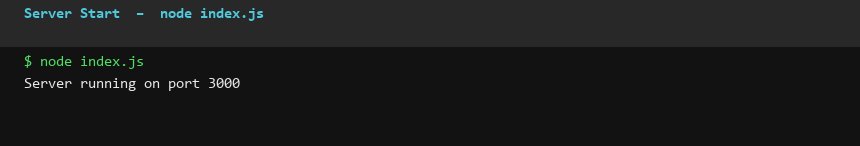

### GET / — API Health Check
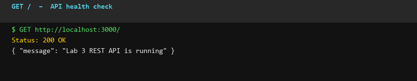

### GET /books — List All Books
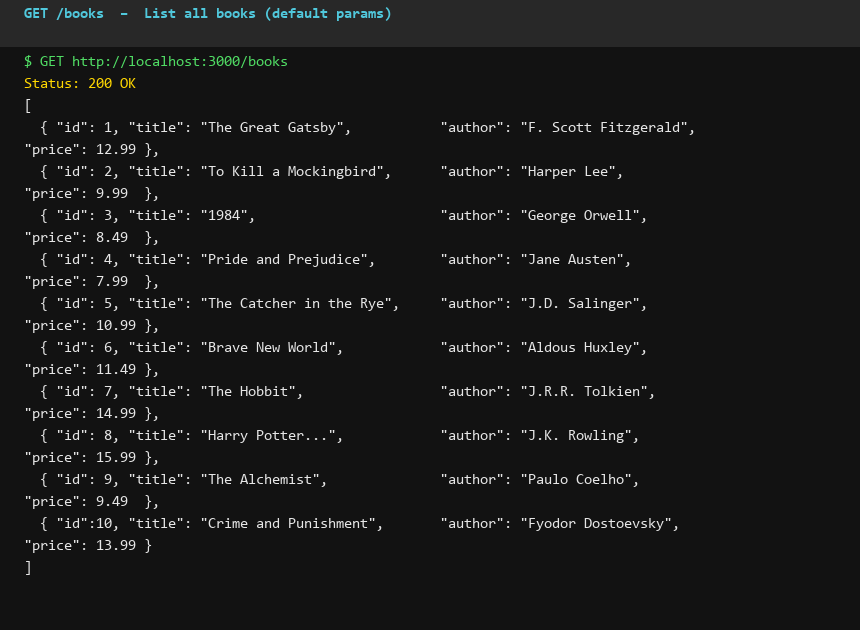

### GET /books?search_q=the&order_by=price&order=ASC — Search & Sort
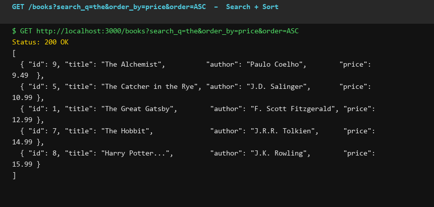

### GET /books?min_price=9&max_price=12 — Price Range Filter
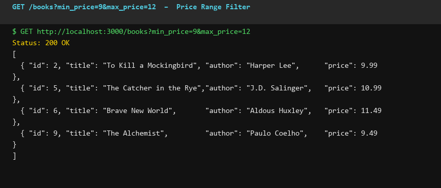

### GET /books?limit=3&offset=0 — Pagination
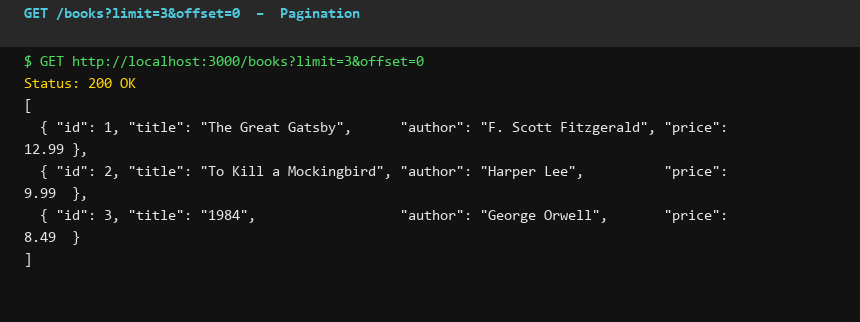

### GET /books/1 — Get Book by ID
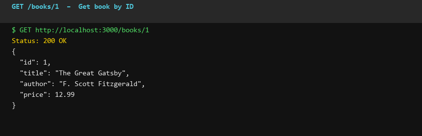

### POST /books — Create Book (201 Created)
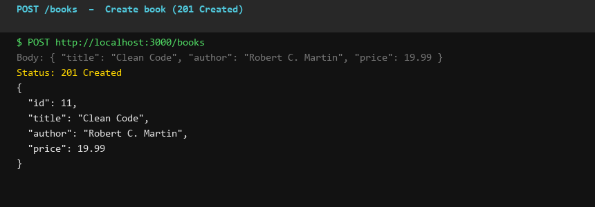

### POST /books — Validation: Missing Title (400 Bad Request)
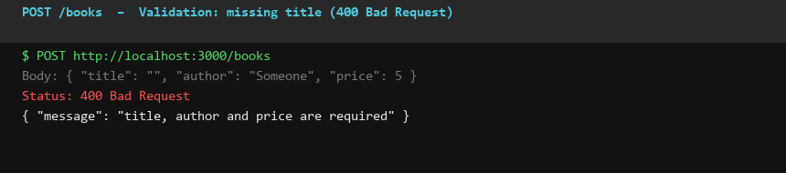

### POST /books — Validation: Non-numeric Price (400 Bad Request)
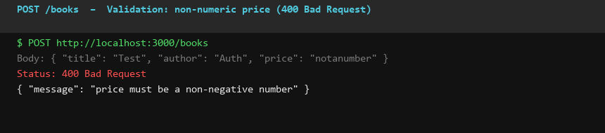

### PUT /books/11 — Update Book (200 OK)
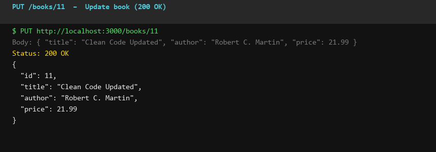

### DELETE /books/11 — Delete Book (200 OK)
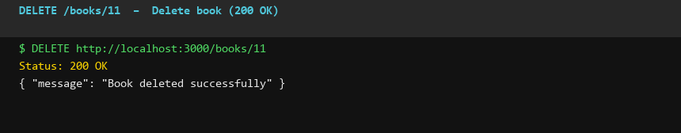

### GET /books/9999 — Book Not Found (404)
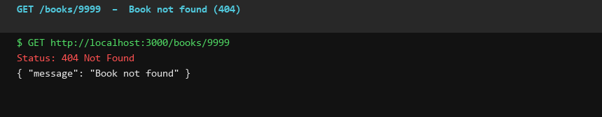

### DELETE /books/11 — Already Deleted (404)
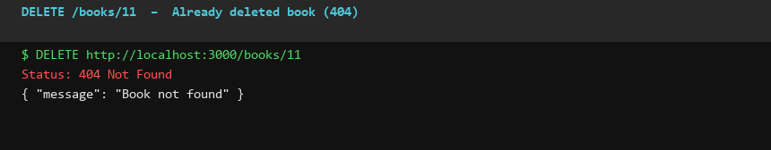

---

## Notes: Problems Faced and How I Solved Them

### Debugging Exercise Fixes

| Bug                        | Symptom                        | Fix                                              |
|----------------------------|--------------------------------|--------------------------------------------------|
| **Port conflict (EADDRINUSE)** | Server crashes on start     | Changed `PORT` in `.env` or killed the process using `npx kill-port 3000` |
| **Wrong import path**      | `Cannot find module './route/books'` | Fixed path to `'./routes/books'` (plural)      |
| **Table-name typo**        | `no such table: book`          | Fixed SQL to use correct table name `books`      |
| **Missing await**          | `undefined` returned from DB calls | Added `await` before all async DB helper calls |

### SQL Injection Prevention
All queries use parameterised placeholders (`?`) — user input is never concatenated into SQL strings.

### ORDER BY Sanitisation
`order_by` and `order` values are validated against an allowlist before being interpolated into the SQL string (the only place parameterised queries cannot be used for column names).
