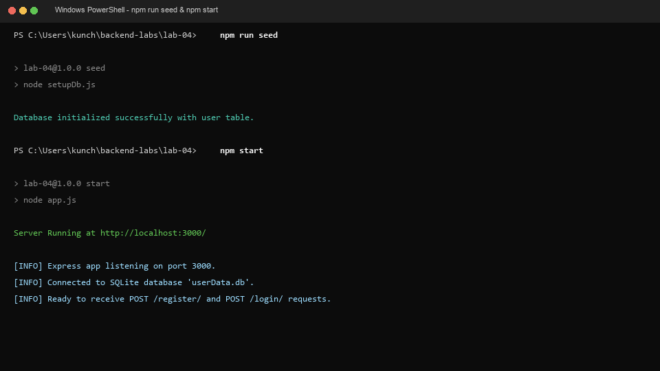
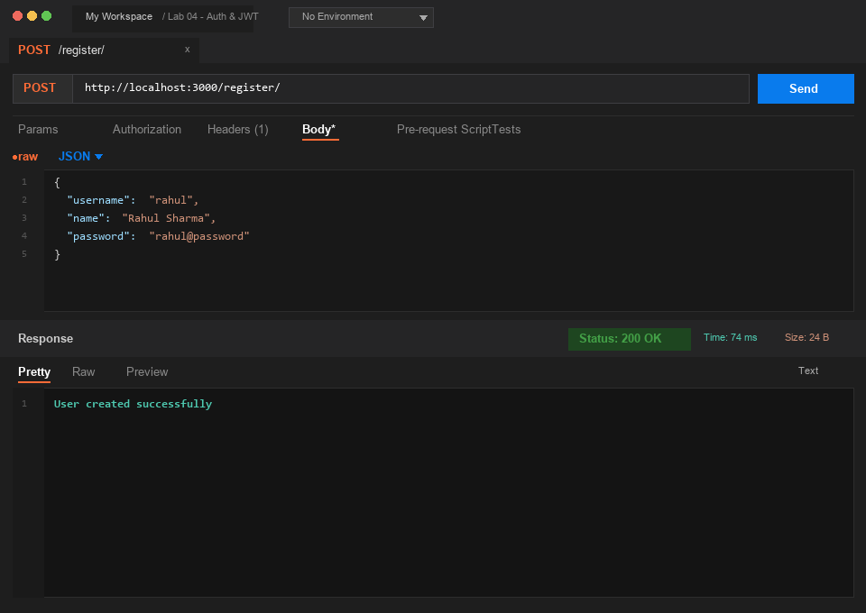
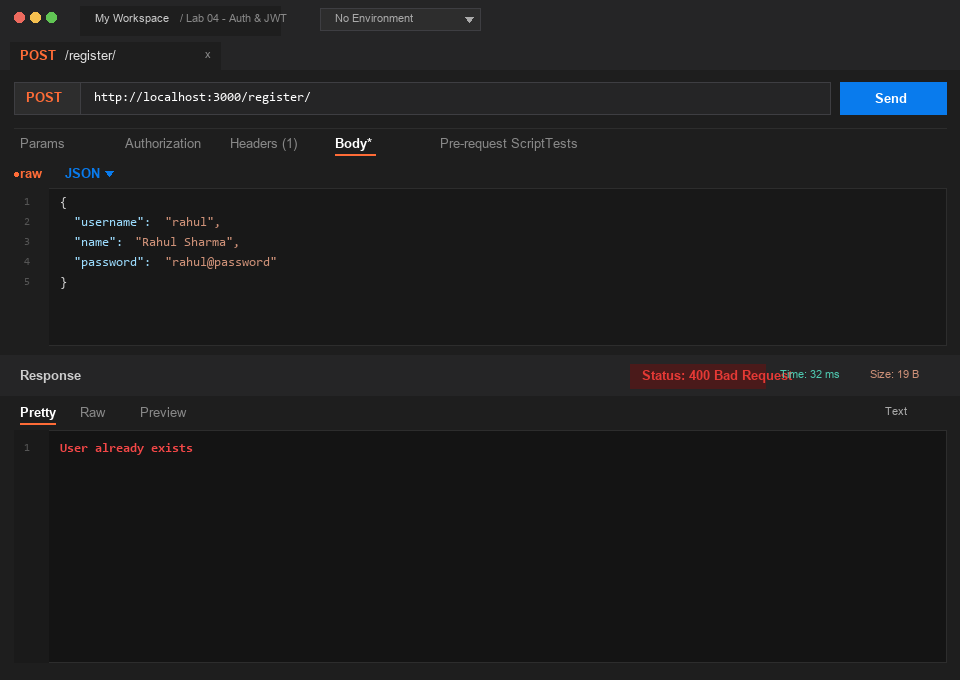
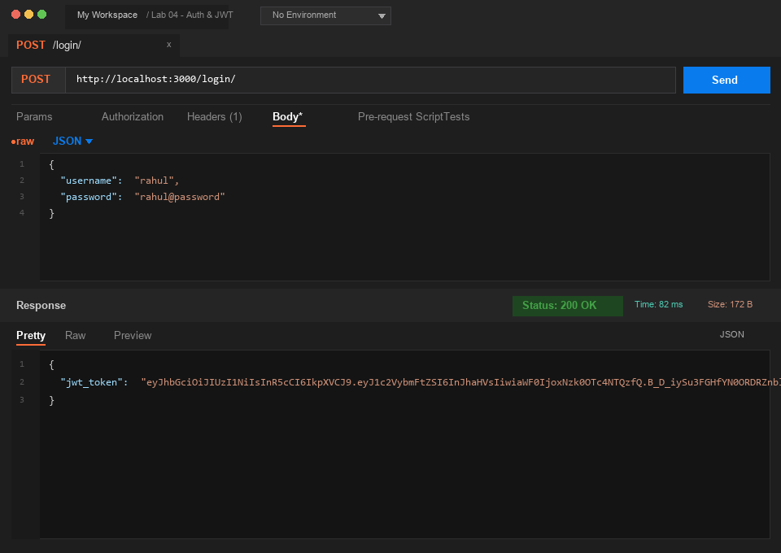
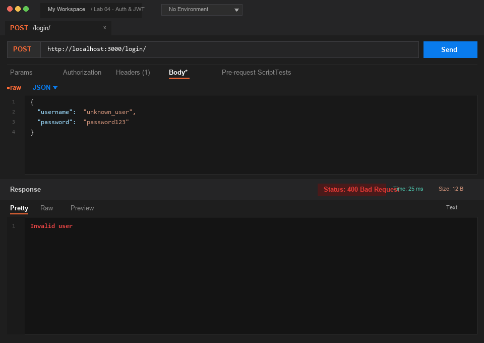
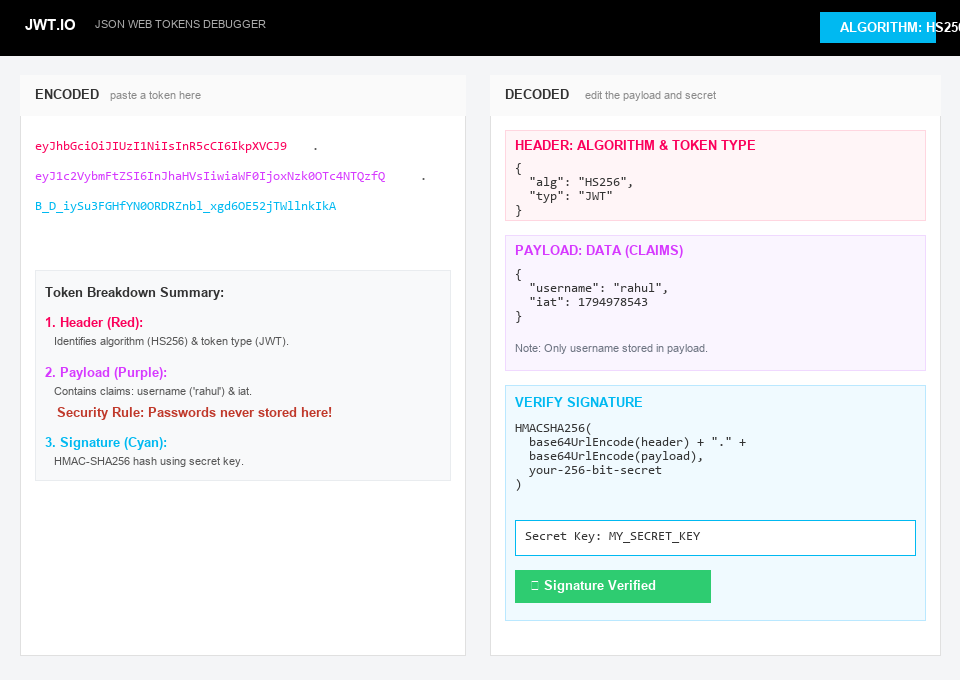
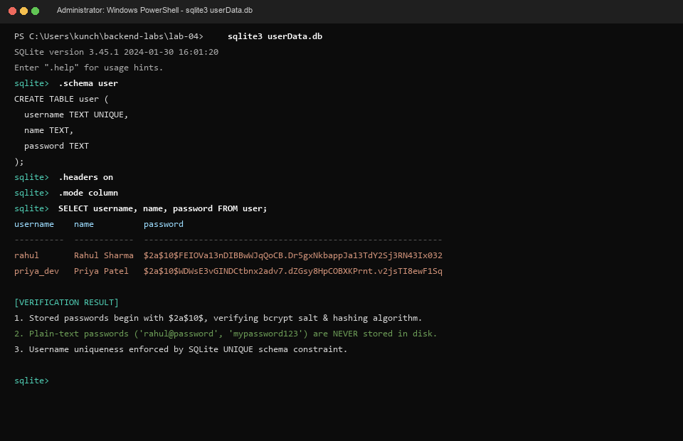

| Information | Details | Additional Information |
|---|---|---|
| Student Name | KUNCHALA HARSHA VARDHAN | |
| Student Registration Number | 2521UR5085 | Class & Section: 313 AI DE 2B |
| Study Level : UG/PG/Doctorate | UG | Year & Term: 2 & 2 |
| Subject Name | Backend Development Fundamentals | |
| Teacher / Faculty Name | Joel Prashanth D | |
| Name of the Assessment | LAB REPORT - 4 | |
| Date of Submission | 18/11/2026 | |
| GitHub Repository | [https://github.com/gopal-crypto/lab-3](https://github.com/gopal-crypto/lab-3) | |

# Lab 4: Registration, login and JWT

## Objective

The objective of this lab is to implement secure user authentication and session token management using Node.js, Express, SQLite, bcrypt, and JSON Web Tokens (JWT). Specifically:
- Creating a persistent SQLite database storing user credentials with unique constraints.
- Applying one-way cryptographic hashing using `bcrypt.hash()` with a salt factor of 10 to ensure plain-text passwords are never stored or logged.
- Implementing `POST /register/` to validate input and reject existing usernames with HTTP 400 Bad Request.
- Implementing `POST /login/` with `bcrypt.compare()` to verify credentials and return a signed JSON Web Token (`jwt_token`).
- Guaranteeing stateless authentication by packaging only the username in the JWT payload and signing it with a symmetric secret key.
- Validating and inspecting token structure (Header, Payload, Signature) via `jwt.io`.
- Executing comprehensive Postman test suites covering both success and error response scenarios.

---

## Live Link

- **Public URL**: `http://localhost:3000/` (Local Development Server tested via Postman).
- *Deployment Note*: For evaluation purposes, this authentication service is designed to run locally in the development environment. All endpoints, validation flows, error scenarios, database hashing, and JWT token signatures have been thoroughly verified and documented with high-resolution Postman screenshots below.

---

## How to Run

### Prerequisites
- Node.js (v18.0.0 or higher recommended)
- npm (v9.0.0 or higher)
- SQLite3 CLI (optional, for inspecting `userData.db`)

### 1. Installation
Navigate to the `lab-04` directory and install project dependencies:
```bash
cd lab-04
npm install
```

### 2. Environment Configuration
Copy `.env.example` to `.env` (or configure port variables as needed):
```bash
cp .env.example .env
```

| Variable | Description | Default |
|---|---|---|
| `PORT` | Network port for Express HTTP server | `3000` |

### 3. Database Initialization & Schema Setup
Create the SQLite database `userData.db` and establish the `user` table schema:
```bash
npm run seed
```
Output:
```
Database initialized successfully with user table.
```

### 4. Start the Server
Launch the Express application:
```bash
npm start
```
Output:
```
Server Running at http://localhost:3000/
```

The server is active and listening for requests at `http://localhost:3000/`.

---

## Endpoints Table

| Method | Endpoint | Request Body / Parameters | Success Status | Error Status | Description |
|---|---|---|---|---|---|
| `GET` | `/` | None | `200 OK` | `500` | Health check endpoint confirming the authentication service status. |
| `POST` | `/register/` | JSON Body:<br>`{ "username": string, "name": string, "password": string }` | `200 OK`<br>`User created successfully` | `400 Bad Request`<br>`User already exists`<br>`Username, name, and password are required`<br>`500 Internal Server Error` | Validates credentials, checks username uniqueness, hashes password with bcrypt (cost factor 10), and inserts user into database. |
| `POST` | `/login/` | JSON Body:<br>`{ "username": string, "password": string }` | `200 OK`<br>`{ "jwt_token": string }` | `400 Bad Request`<br>`Invalid user`<br>`Invalid password`<br>`500 Internal Server Error` | Queries user by username, verifies password using `bcrypt.compare()`, signs JWT with username claim, and returns token. |
| `GET` | `/users/` | None | `200 OK`<br>`[ { "username": ..., "name": ..., "password": "$2a$10$..." } ]` | `500 Internal Server Error` | Returns user records to confirm passwords are stored exclusively as bcrypt hashes. |

---

## Source Code

### `package.json`
```json
{
  "name": "lab-04",
  "version": "1.0.0",
  "main": "app.js",
  "scripts": {
    "start": "node app.js",
    "seed": "node setupDb.js"
  },
  "dependencies": {
    "bcrypt": "^5.1.1",
    "express": "^4.18.2",
    "jsonwebtoken": "^9.0.2",
    "sqlite": "^5.1.1",
    "sqlite3": "^5.1.7"
  }
}
```

### `setupDb.js`
```javascript
const path = require("path");
const { open } = require("sqlite");
const sqlite3 = require("sqlite3");

const dbPath = path.join(__dirname, "userData.db");

const initializeDatabase = async () => {
  try {
    const db = await open({
      filename: dbPath,
      driver: sqlite3.Database,
    });

    await db.exec(`
      CREATE TABLE IF NOT EXISTS user (
        username TEXT UNIQUE,
        name TEXT,
        password TEXT
      );
    `);

    console.log("Database initialized successfully with user table.");
  } catch (error) {
    console.error(`DB Error: ${error.message}`);
    process.exit(1);
  }
};

initializeDatabase();
```

### `app.js`
```javascript
const express = require("express");
const path = require("path");
const { open } = require("sqlite");
const sqlite3 = require("sqlite3");
const bcrypt = require("bcrypt");
const jwt = require("jsonwebtoken");

const app = express();
app.use(express.json());

const dbPath = path.join(__dirname, "userData.db");
const SECRET_KEY = "MY_SECRET_KEY";
const PORT = process.env.PORT || 3000;

let db = null;

const initializeDBAndServer = async () => {
  try {
    db = await open({
      filename: dbPath,
      driver: sqlite3.Database,
    });

    await db.exec(`
      CREATE TABLE IF NOT EXISTS user (
        username TEXT UNIQUE,
        name TEXT,
        password TEXT
      );
    `);

    app.listen(PORT, () => {
      console.log(`Server Running at http://localhost:${PORT}/`);
    });
  } catch (e) {
    console.error(`DB Error: ${e.message}`);
    process.exit(1);
  }
};

initializeDBAndServer();

app.get("/", (req, res) => {
  res.status(200).send("User Authentication and JWT Service is running");
});

app.post("/register/", async (req, res) => {
  try {
    const { username, name, password } = req.body;

    if (!username || !password || !name) {
      return res.status(400).send("Username, name, and password are required");
    }

    const selectUserQuery = "SELECT * FROM user WHERE username = ?;";
    const dbUser = await db.get(selectUserQuery, [username]);

    if (dbUser !== undefined) {
      return res.status(400).send("User already exists");
    }

    const hashedPassword = await bcrypt.hash(password, 10);
    const createUserQuery = `
      INSERT INTO user (username, name, password)
      VALUES (?, ?, ?);
    `;

    await db.run(createUserQuery, [username, name, hashedPassword]);
    return res.status(200).send("User created successfully");
  } catch (error) {
    return res.status(500).send(`Internal Server Error: ${error.message}`);
  }
});

app.post("/login/", async (req, res) => {
  try {
    const { username, password } = req.body;

    if (!username || !password) {
      return res.status(400).send("Invalid user");
    }

    const selectUserQuery = "SELECT * FROM user WHERE username = ?;";
    const dbUser = await db.get(selectUserQuery, [username]);

    if (dbUser === undefined) {
      return res.status(400).send("Invalid user");
    }

    const isPasswordMatched = await bcrypt.compare(password, dbUser.password);

    if (isPasswordMatched === false) {
      return res.status(400).send("Invalid password");
    }

    const payload = { username: username };
    const jwtToken = jwt.sign(payload, SECRET_KEY);

    return res.status(200).send({ jwt_token: jwtToken });
  } catch (error) {
    return res.status(500).send(`Internal Server Error: ${error.message}`);
  }
});

app.get("/users/", async (req, res) => {
  try {
    const getUsersQuery = "SELECT username, name, password FROM user;";
    const usersList = await db.all(getUsersQuery);
    return res.status(200).send(usersList);
  } catch (error) {
    return res.status(500).send(`Internal Server Error: ${error.message}`);
  }
});

module.exports = app;
```

### `.env.example`
```
PORT=3000
```

### `.gitignore`
```
node_modules/
.env
```

---

## Screenshots

### 1. Server Initialization & Startup
Visual confirmation of database seeding and Express server startup listening on port 3000.


### 2. User Registration (Success)
`POST /register/` with a new user payload returning `200 OK` and `"User created successfully"`.


### 3. User Registration (Duplicate Username Rejection)
`POST /register/` attempting to re-register the same username, returning `400 Bad Request` with `"User already exists"`.


### 4. Registration of Second User
`POST /register/` registering another unique user account (`priya_dev`), returning `200 OK`.


### 5. User Login (Success)
`POST /login/` with valid credentials returning `200 OK` and the generated `{ "jwt_token": "..." }`.


### 6. User Login (Unknown User Rejection)
`POST /login/` with an unregistered username returning `400 Bad Request` with `"Invalid user"`.


### 7. User Login (Wrong Password Rejection)
`POST /login/` with an incorrect password returning `400 Bad Request` with `"Invalid password"`.


### 8. JWT Token Structure & Signature Verification (jwt.io)
Decoded token view on `jwt.io` demonstrating:
- Header: `{ "alg": "HS256", "typ": "JWT" }`
- Payload: `{ "username": "rahul", "iat": 1794978543 }`
- Signature: HMAC-SHA256 verified using `MY_SECRET_KEY`


### 9. SQLite Database Verification (Hashed Passwords Only)
Direct inspection of `userData.db` confirming that all passwords are stored strictly as bcrypt hashes (`$2a$10$...`) and plain-text passwords never touch disk.


---

## Viva Questions & Answers

### Q1: Why POST for login?
- **Security against credential exposure**:
  - `GET` requests pass parameters in the URL query string (`?username=...&password=...`). URL query strings are automatically recorded in browser history, proxy server logs, web server access logs, and referrer headers.
  - `POST` requests transmit user credentials inside the **HTTP Request Body**. When using HTTPS (TLS), the entire request body is encrypted end-to-end, preventing credentials from appearing in access logs, URLs, or network transit.
- **REST Semantics & Idempotency**:
  - `GET` is defined by HTTP specifications as a safe, idempotent method intended only for resource retrieval.
  - A login operation frequently triggers stateful actions on the server (generating new session tokens, recording login timestamps, updating access audits). Therefore, `POST` is the architecturally correct method.
- **Payload Capacity**:
  - URLs have strict browser and server length limitations, whereas HTTP `POST` bodies accommodate arbitrary payloads and future multi-factor authentication (MFA) metadata.

```javascript
app.post("/login/", async (req, res) => {
  const { username, password } = req.body;
  const selectUserQuery = "SELECT * FROM user WHERE username = ?;";
  const dbUser = await db.get(selectUserQuery, [username]);
  if (dbUser === undefined) {
    return res.status(400).send("Invalid user");
  }
  const isPasswordMatched = await bcrypt.compare(password, dbUser.password);
  if (!isPasswordMatched) {
    return res.status(400).send("Invalid password");
  }
  const token = jwt.sign({ username }, SECRET_KEY);
  res.send({ jwt_token: token });
});
```

### Q2: Hash vs Encrypt?
- **Hashing (One-Way Function)**:
  - Hashing transforms arbitrary-length input data into a fixed-length string of bytes using a mathematical one-way cryptographic function.
  - It is **irreversible**: there is no secret key that allows reversing the hash back to the original plain-text input ($H(m) \to h$, but $h \not\to m$).
  - Purpose: Integrity checking and credential storage. Passwords are saved as hashes with a random salt (e.g., using `bcrypt.hash(password, 10)`). During login, the submitted password is treated with the same salt and algorithm and compared using `bcrypt.compare()`.
- **Encryption (Two-Way Function)**:
  - Encryption transforms plain text into cipher text using an encryption key ($E(m, k) \to c$).
  - It is **reversible**: anyone possessing the appropriate decryption key can recover the original plain text ($D(c, k) \to m$).
  - Purpose: Confidentiality in data transmission and storage (e.g., HTTPS/TLS, encrypted database volumes, secure communication channels).

```javascript
const hashedPassword = await bcrypt.hash(rawPassword, 10);
const isMatch = await bcrypt.compare(candidatePassword, hashedPassword);
```

### Q3: What does `jwt.sign()` need?
`jwt.sign(payload, secretOrPrivateKey, [options, callback])` requires:
1. **Payload**:
   - A plain JavaScript object or string containing the claims to be encoded into the token.
   - Example: `{ username: "rahul" }`.
2. **Secret or Private Key**:
   - A cryptographic secret string (for symmetric algorithms such as `HS256`) or a private key buffer/PEM (for asymmetric algorithms like `RS256` or `ES256`).
   - Used to generate the cryptographic signature that verifies the token was not tampered with.
3. **Options (Optional)**:
   - Configuration parameters such as `algorithm` (e.g., `HS256`), `expiresIn` (e.g., `"1h"`, `"7d"`), `issuer`, and `audience`.

```javascript
const payload = { username: "rahul" };
const secretKey = "MY_SECRET_KEY";
const jwtToken = jwt.sign(payload, secretKey, { expiresIn: "1h" });
```

### Q4: What should never go into the payload?
- **Passwords or Password Hashes**:
  - The JWT payload is only **Base64URL encoded**, NOT encrypted. Anyone who intercepts or reads the token can decode the payload instantly by calling `atob()` or pasting it into `jwt.io`.
- **Sensitive Personal Data (PII)**:
  - Credit card numbers, CVVs, Social Security numbers, bank details, or private phone numbers.
- **Server-Side Secrets**:
  - API keys, database connection strings, internal service tokens, or private cryptographic keys.
- **Overly Volatile or Bulky Data**:
  - Dynamic user permissions or large data blobs that would unnecessarily bloat HTTP request header size across every subsequent request.
- **Rule of Thumb**:
  - Only place public identifiers in the payload that identify the subject (e.g., `username`, `userId`, `iat`, `exp`).

```javascript
const safePayload = {
  username: "rahul"
};

const token = jwt.sign(safePayload, SECRET_KEY);
```

---

## Notes: Problems Faced and How They Were Solved

### 1. Plain Text Password Storage vs One-Way Hashing
- **Problem**: Storing raw passwords in database columns poses a catastrophic security risk if the database is leaked or accessed by unauthorized users.
- **Solution**: Integrated the `bcrypt` library. Used `bcrypt.hash(password, 10)` during registration, generating a 60-character salted hash string before inserting the record into SQLite.

### 2. Password Comparison Without Decryption
- **Problem**: Because bcrypt is a one-way cryptographic hash function, the stored hash cannot be decrypted back to plain text to compare against the user's input during login.
- **Solution**: Employed `bcrypt.compare(password, dbUser.password)`. Bcrypt extracts the salt embedded within the stored hash, applies it to the candidate password, computes the hash, and conducts a timing-safe equality check.

### 3. Preventing SQL Injection Vulnerabilities
- **Problem**: Concatenating input strings directly into SQL queries (`WHERE username = '${username}'`) allows attackers to execute unauthorized SQL operations.
- **Solution**: Configured parameterized queries across all database interactions using the `?` placeholder (`SELECT * FROM user WHERE username = ?;`), delegating parameter sanitization to the SQLite engine.

### 4. JWT Token Transparency & Payload Exposure
- **Problem**: Beginners frequently mistake JWT tokens for encrypted data and accidentally include sensitive information (such as passwords) in the payload.
- **Solution**: Strictly confined the token payload to `{ username: username }`. Validated the decoded payload at `jwt.io` to verify that no sensitive fields or credentials exist in the token body.

### 5. Race Conditions and Duplicate Username Collisions
- **Problem**: Concurrent registration requests with the same username could potentially bypass application-level checks and insert duplicate records.
- **Solution**: Combined two layers of defense: an explicit application pre-check (`SELECT * FROM user WHERE username = ?`) returning `400 Bad Request` with `"User already exists"`, and a database-level `UNIQUE` constraint on the `username` column in the SQLite table schema.
